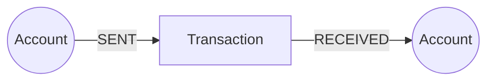
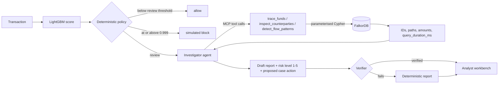
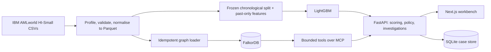

# Tripwire

**An AML investigator agent that follows the money through a FalkorDB graph, cites every transfer it relies on, and is allowed to say "nothing found".**

Built for **Graph Hacks: Context for AI Agents** (WeMakeDevs x FalkorDB, Oct 15-18, 2026).
**Track:** 01, Agents That Act on Connected Data.

| | |
| --- | --- |
| Live deployment | https://tripwire.parthgarg.me |
| Demo video | https://youtu.be/EI_i-Osb0kg |
| Blog post | https://dev.to/priyanshusingh9/follow-the-money-building-a-graph-based-aml-investigator-with-falkordb-4b5l |
| Story and use cases | `/docs` on the live site (the bank, the money-flow network, the AML patterns, and the Coinbase field note) |
| Graph model | [Graph data model](#graph-data-model) |
| Cypher | [The Cypher the product depends on](#the-cypher-the-product-depends-on), full file in [`graph/queries.cypher`](graph/queries.cypher) |
| Setup | [Run it locally](#run-it-locally) |

> Synthetic data only (IBM AMLworld HI-Small). Tripwire is a research demo. It does not connect to banks, freeze funds, or file reports, and its numbers say nothing about real-world AML performance.

---

## TL;DR

A fraud model scores **one row**. Laundering lives in **what happens next**: the receiver forwards almost the same amount an hour later, then the next account does it again. Tripwire keeps the model for ranking and gives the *review* to an agent that walks the graph.

1. **LightGBM** scores every transaction (76 past-only features). Deterministic policy routes it to `allow`, `review`, or a simulated `block`.
2. For a flagged transaction, the **investigator agent** picks from three bounded graph tools served over **MCP**: `trace_funds`, `inspect_counterparties`, `detect_flow_patterns`. It never writes Cypher.
3. Every tool runs fixed, parameterised Cypher on **FalkorDB** (5,078,345 transactions) and returns transaction IDs, amounts, paths and `query_duration_ms`.
4. A **verifier** checks every ID, path, amount and date in the report against what the tools actually returned. Anything unverified is dropped.
5. The analyst sees the evidence subgraph grow live in the workbench, with the exact Cypher that ran.

**Take FalkorDB out and the agent has nothing to investigate.** The score still exists, but there are no paths, no counterparties, no fan-out or pass-through evidence, no citations, and no report.

---

## Why the graph does the work

The questions an AML reviewer asks are multi-hop by nature:

- Where did this money go next, and next after that, inside the window?
- Who is on each side, and what else have they been doing?
- Is this account fanning out, collecting (fan-in), or passing money straight through?

In a table, each hop is a self-join on a five-million-row table. In FalkorDB it is one pattern anchored on an indexed node, and cost grows with that node's degree, not with the size of the graph.

| What the agent does | Where the answer comes from |
| --- | --- |
| Follows funds 1-3 hops upstream or downstream | `trace_funds`, Cypher path patterns over `SENT`/`RECEIVED` |
| Lists counterparties and their other activity | `inspect_counterparties`, account-anchored expansions |
| Tests for fan-out, fan-in, pass-through | `detect_flow_patterns`, aggregation over one account's adjacency |
| Cites evidence | Transaction node IDs returned by those queries (`hi8-tx-{row}`) |
| Refuses to over-claim | `no_matching_path` when the graph returns nothing inside the bounds |
| Proposes an action (`open_case` / `enrich_case`) | Applied by code only if graph evidence was found and verified |

### Two real cases from the full graph

- **`hi8-tx-03863669`** (score rank 1 of 761,639 held-out transactions). At depth 2, `trace_funds` returns **65 paths through 15 transactions**; `detect_flow_patterns` finds **7 counterparties and 7 fan-out matches**. A Cypher bug once made this look like 2 counterparties and no fan-out (see [what we fixed](#what-we-fixed-in-the-graph-layer)).
- **`hi8-tx-03988788`**, a quiet transaction from the same slice. The investigation returns `outcome: no_matching_path`: zero paths, seven related transfers on record. The workbench says: *"The graph was queried and nothing matched within these bounds. This is not evidence that the transaction is safe."*

---

## Graph data model



```text
(:Account)-[:SENT]->(:Transaction)-[:RECEIVED]->(:Account)
```

Each transfer is a **first-class node**, so the agent can cite it by a stable ID and a path is a list of real records, not something inferred from edges. We started with `(:Account)-[:TRANSFER]->(:Account)` and promoted transfers to nodes for exactly this reason.

| Label | Properties (explicit allowlist) |
| --- | --- |
| `Account` | `account_key` (`{bank}::{account}`), `bank`, `account_id`, `last_epoch` (latest sent-or-received time, kept by the loader) |
| `Transaction` | `transaction_id` (`hi8-tx-{row:08d}`), `timestamp`, `timestamp_epoch`, `sender_account_key`, `receiver_account_key`, `amount_paid`, `payment_currency`, `amount_received`, `receiving_currency`, `payment_format` |

| Relationship | Meaning |
| --- | --- |
| `(:Account)-[:SENT]->(:Transaction)` | the account paid this transfer |
| `(:Transaction)-[:RECEIVED]->(:Account)` | this transfer landed in the account |

**Indexes** ([`graph/schema.cypher`](graph/schema.cypher), [`graph/indexes.cypher`](graph/indexes.cypher)):

```cypher
CREATE INDEX FOR (a:Account) ON (a.account_key);
CREATE INDEX FOR (t:Transaction) ON (t.transaction_id);
```

Both keys also have unique constraints. There is deliberately **no timestamp index** (ADR-017): it made the planner scan every transaction in the window instead of starting from the indexed account.

**Labels never enter the graph.** `target_is_laundering`, the split, and typology ground truth are excluded by the loader's allowlist. `CALL db.propertyKeys()` on the loaded graph lists only allowlisted properties, so nothing, the agent included, can peek.

**Size at full scale:** 5,078,345 transactions, 515,088 accounts, loaded in 520.9 s, **2,514 MB** of graph memory. All `Transaction`, `SENT` and `RECEIVED` counts reconciled.

---

## The Cypher the product depends on

All statements live in [`graph/queries.cypher`](graph/queries.cypher), which is generated from [`graph/src/graph/queries.py`](graph/src/graph/queries.py). A test asserts the two match.

Bounds on every tool query:

| Bound | Value |
| --- | --- |
| Hop depth | 1-3 (fixed `MATCH` variants, no dynamic bounds) |
| Time window | 1 s to 30 days, integer seconds |
| Row limit | 1-100 (`LIMIT $result_limit`) |
| Timeout | client-side `timeout=` on `graph.query`, default 5 s, max 30 s |

Every value is a bound parameter. The agent picks a tool and validated arguments, never a query string.

**`trace_funds`**, outgoing branch at depth 2:

```cypher
MATCH (anchor:Transaction {transaction_id: $transaction_id})
WITH anchor, anchor.timestamp_epoch - $time_window_seconds AS lo,
     anchor.timestamp_epoch + $time_window_seconds AS hi
MATCH (anchor)-[:RECEIVED]->(a0)-[:SENT]->(t1)-[:RECEIVED]->(a1)-[:SENT]->(t2)-[:RECEIVED]->(a2)
WHERE t1.timestamp_epoch >= lo AND t1.timestamp_epoch <= hi
  AND t2.timestamp_epoch >= lo AND t2.timestamp_epoch <= hi
RETURN anchor.transaction_id, t1.transaction_id, t1.amount_paid,
       t2.transaction_id, t2.amount_paid, a0.account_key, a1.account_key, a2.account_key
LIMIT $result_limit
```

**`inspect_counterparties`**, both ends of a transaction:

```cypher
MATCH (anchor:Transaction {transaction_id: $transaction_id})
MATCH (sender:Account)-[:SENT]->(anchor)-[:RECEIVED]->(receiver:Account)
RETURN anchor.transaction_id, anchor.timestamp,
       sender.account_key AS sender_key, receiver.account_key AS receiver_key,
       anchor.amount_paid, anchor.payment_currency,
       anchor.amount_received, anchor.receiving_currency, anchor.payment_format
LIMIT 1
```

**`detect_flow_patterns`**, fan-out at an account (fan-in mirrors it over `RECEIVED`):

```cypher
MATCH (a:Account {account_key: $account_key})
WITH a
MATCH (a)-[:SENT]->(t)
WHERE t.timestamp_epoch >= $min_epoch AND t.timestamp_epoch <= $max_epoch
WITH t ORDER BY t.timestamp_epoch
WITH count(DISTINCT t.receiver_account_key) AS distinct_counterparties,
     count(t) AS transfers, collect(t) AS ordered
RETURN distinct_counterparties, transfers,
  CASE WHEN distinct_counterparties >= $min_fanout
    THEN [x IN ordered[0..$result_limit] | [x.receiver_account_key, x.transaction_id,
      x.timestamp, x.amount_paid, x.payment_currency, x.amount_received, x.receiving_currency]]
    ELSE [] END AS details
```

**Pass-through** runs in three steps so it never builds the incoming x outgoing cross product: an outgoing timestamp histogram (`TRACE_PASS_THROUGH_OUT_HISTOGRAM`), the first qualifying incoming legs (`TRACE_PASS_THROUGH_FIRST_INCOMING`), then the detail fetch at only those epochs (`TRACE_PASS_THROUGH_DETAIL`).

No `algo.*` procedures are used. FalkorDB features we rely on: parameterised Cypher, range indexes plus unique constraints, `db.propertyKeys()` as a leakage check, client-side query timeouts, `GRAPH.MEMORY USAGE` and `INFO memory` for capacity, and FalkorDB Browser (localhost:3001) for inspecting paths.

---

## How the agent decides



- **The LLM never gets the last word.** The model scores and policy decides. The agent proposes a risk level from 1 to 5; code verifies it, then maps 4-5 to a simulated block and 1-3 to an allow. With no verified level, the transaction stays flagged for a human. The agent can't reverse an upstream block (ADR-006, ADR-023).
- **Gemini is opt-in.** The default report is deterministic, with the same tools and the same verifier. `use_llm: true` on a request turns the Gemini agent on (`gemini-flash-latest` by default). Any provider failure falls back to the deterministic report (ADR-020).
- **MCP is the tool boundary.** `api.mcp_graph` serves the three tools as typed, bounded MCP tools that delegate to the same queries. The agent calls them through a real MCP client session by default; `TRACEAML_AGENT_TOOL_TRANSPORT=direct` bypasses it. External clients can use the same server over stdio: `python -m api.mcp_graph` (ADR-021).
- **Outcomes are honest.** Each tool returns `evidence_found`, `no_matching_path`, `unknown_anchor`, or `inconclusive`. A capped result with no path counts as `inconclusive`, never as a clean negative.
- **Actions are gated.** `open_case` / `enrich_case` are applied only when evidence was found and every cited reference exists. Cases are written to a SQLite case store (never to FalkorDB) and stay `suspected` until an analyst confirms or dismisses them.
- **Streaming.** `POST /api/investigations/stream` sends server-sent events as each tool call starts and finishes, with the Cypher that actually ran, so the evidence graph grows on screen.

---

## Architecture



| Layer | Stack |
| --- | --- |
| Web (`apps/web/`) | Next.js, React Flow + dagre (evidence graph), Apache ECharts, Zod, Better Auth (Google/GitHub) |
| API (`services/api/`) | FastAPI, Pydantic, MCP server (`mcp` < 2.0), `google-genai`, SSE, SQLite case store |
| Graph (`graph/`) | FalkorDB 4.22.1, `falkordb-py`, loader + bounded queries |
| ML (`ml/`) | Polars, DuckDB, PyArrow, LightGBM 4.7.0 |
| Bench (`bench/`) | Latency, capacity and cost suite (`make bench`) |
| Deploy (`deploy/`) | Docker Compose, Caddy (TLS), one server |

**Workbench screens:** `/` landing, `/overview` alert queue (server-side filters over all 761,639 scored test transactions), `/investigation` the case view with the live evidence graph, tool-call cards, Cypher and verdict, `/performance` benchmarks, `/docs` the story and use cases.

**API:** `GET /api/health`, `GET /api/me`, `GET /api/alerts`, `GET /api/benchmarks`, `POST /api/investigations`, `POST /api/investigations/stream`, `/api/cases` (list, create, get, review). Interactive docs at `/docs` on the API.

---

## Results

All on synthetic IBM AMLworld HI-Small v8. Measured on a shared dev machine, serial, single client.

### Graph latency at full scale (5,078,345 transactions)

| Tool | Demo case P50 / P95 (ms) | High-degree anchors P95 (ms) |
| --- | ---: | ---: |
| `trace_funds` (2 hops) | 11.9 / 18.0 | 133 |
| `inspect_counterparties` | 3.9 / 8.1 | 86.5 |
| `fan_out` | 2.4 / 3.7 | 53.9 |
| `fan_in` | 1.8 / 2.8 | 5.0 |
| `pass_through` | 2.2 / 3.4 | 59.2 |
| **Full investigation (5 calls)** | **23.2 / 29.3** | **207** |

The top hub accounts have 169,756 connections. Iteration 1's investigation took about 3.5 s on a 1M-transaction slice.

### What we fixed in the graph layer

1. **Planner picked the wrong index.** A `timestamp_epoch` range index made account-anchored queries scan every transaction in the window (528,982 rows for one day) first. We dropped it and bound the indexed anchor with `WITH` before expanding.
2. **`UNION ... ORDER BY ... LIMIT` binds only to the last branch.** The "latest activity" lookup was wrong for 497 of 500 accounts, which ended windows early: 7 counterparties became 2. It also let a 3-hop trace with `LIMIT 50` return 3,404 paths. `Account.last_epoch` now carries this value.
3. **Pass-through built a cross product.** It now uses a histogram first.
4. **Pointless second hops** to read keys the transaction node already stored.

The old statements are frozen in `graph/src/graph/legacy_queries.py`, and equivalence tests check every tool against them.

### Detection (frozen test cohort, 761,639 rows, 0.205% positive)

| Model | Test AP | Recall at 0.1% alert budget | Sept 9-10 bulk AP |
| --- | ---: | ---: | ---: |
| Iteration 1 LightGBM baseline | 0.1587 | 15.89% | 0.0877 |
| C3: Iteration 1 features, new regularisation | 0.2409 | 21.40% | 0.1503 |
| C2: all families except account registry | 0.7326 | 47.53% | 0.5744 |
| **C1: all seven families (selected)** | **0.7525** | **47.73%** | **0.5996** |

- Candidates were committed before any test look, and each was scored on test once (`test_ledger.jsonl`).
- **Trust the Sept 9-10 bulk number.** The last 1,108 test rows are 59% laundering and easy for every model, so they inflate the full-cohort figure.
- The leakage audits (truncation, same-minute perturbation, brute-force reference tests) found no leakage.
- **Caveat:** these figures predate a fix to `log_received_over_paid`, which compared raw amounts across currencies. The guard is in, but the corrected model has not had its own test look yet.

Full reports: [`docs/benchmarks/`](docs/benchmarks/).

---

## Run it locally

**Requirements:** Node.js 20.9+ and pnpm, Python 3.12+ and uv, Docker Compose, GNU Make (`winget install ezwinports.make` on Windows).

```bash
git clone https://github.com/PriyanshuSingh9/tripwire && cd tripwire
make setup                      # .env from .env.example, web + Python deps
make up                         # FalkorDB on :6379, FalkorDB Browser on :3001
```

**Data.** Put IBM AMLworld HI-Small (Kaggle `ealtman2019/ibm-transactions-for-anti-money-laundering-aml`, version 8; CDLA-Sharing-1.0) in `data/raw/hi-small/`:

- `HI-Small_Trans.csv`
- `HI-Small_accounts.csv`
- `HI-Small_Patterns.txt`

The data files are git-ignored and not shipped in this repo.

```bash
make data                                   # inspect, prepare, features, train, publish scores
make graph-load GRAPH_NAME=traceaml         # full graph (~9 min); or:
make graph-load-demo                        # two-day slice around hi8-tx-03863669 (~1 min)
make dev-api                                # FastAPI on http://127.0.0.1:8000 (docs at /docs)
make dev-web                                # workbench on http://localhost:3000
```

**Try it:** open `/overview`, pick the top alert (`hi8-tx-03863669`), and run an investigation. To turn on the Gemini agent, set `LLM_API_KEY` in `.env` (a Google AI Studio key); requests with `"use_llm": true` then use it. Local auth is off by default (`TRACEAML_AUTH_MODE=off`, `AUTH_MODE=off`).

**Checks:** `make check` runs lint, tests and the web build. `make bench` runs the latency, capacity and cost suite. `make help` lists every target.

**Deploy:** [`docs/deployment.md`](docs/deployment.md) covers AWS EC2 step by step, plus ECS, Google Cloud and Azure. The production stack is `deploy/compose.prod.yaml`: Caddy (TLS), web, API, FalkorDB, and a one-shot graph loader.

---

## Repository map

```text
apps/web/        Next.js analyst workbench (landing, overview, investigation, performance, docs)
services/api/    FastAPI: scoring, policy, investigations, MCP server, verifier, LLM agent, cases, auth
graph/           FalkorDB schema, indexes, loader, bounded queries (queries.cypher)
ml/              Data protocol, feature families, models, evaluation
bench/           Latency, capacity and cost benchmark suite
deploy/          Production compose, Caddyfile, scripts
docs/            Architecture, contracts, decisions (ADRs), benchmarks, PRD, deployment
AGENTS.md        Invariants for coding agents working in this repo
```

---

## For AI agents reading this repo

Start here, in this order:

1. [`AGENTS.md`](AGENTS.md): invariants and toolchain rules (pnpm for web, uv for Python, no labels in the graph, policy owns decisions).
2. [`docs/architecture.md`](docs/architecture.md) and [`docs/contracts.md`](docs/contracts.md): system boundaries, API and graph contracts.
3. [`docs/decisions.md`](docs/decisions.md): ADR-001 to ADR-027. Graph decisions are ADR-002, 003 and 017. Agent decisions are ADR-020, 021 and 023.
4. [`graph/queries.cypher`](graph/queries.cypher): every query the product runs.

Facts to rely on:

- Graph schema: `(:Account)-[:SENT]->(:Transaction)-[:RECEIVED]->(:Account)`. The graph name is `traceaml`.
- Tools: `trace_funds`, `inspect_counterparties`, `detect_flow_patterns`. MCP server: `services/api/src/api/mcp_graph.py`.
- Never add label, split, or typology properties to the graph or to inference responses.
- Never let model or LLM output set `allow` / `review` / `block`.
- Report claims must cite IDs returned by the tools. The verifier lives in `services/api/src/api/verifier.py`.
- Environment variables are in [`.env.example`](.env.example).

---

## Limitations

- Synthetic data. AMLworld laundering follows scripted typologies, so recency and account-age features may exploit generator regularities that real data wouldn't have.
- Blocks are simulated. The `0.999` block threshold is a placeholder, not chosen from validation.
- The Gemini agent path is tested with a scripted model and stubs. It has had little live exercise.
- The reviewer ID on a case is typed by the analyst and not yet tied to the signed-in user.
- Detection numbers predate the cross-currency feature fix (see [Results](#results)).

---

## AI-assistant disclosure

AI coding assistants were used during this hackathon, as the rules allow. `<NAME THE TOOLS, e.g. Claude Code / Codex / Cursor / ChatGPT>` were used for code generation, refactoring, test scaffolding, and drafting docs and the blog. `AGENTS.md` is the brief we gave them. The graph model, the queries, the evaluation protocol, the policy design and every technical decision are the team's own. We reviewed, tested and benchmarked all generated code, and each of us can explain the parts we own.

---

## Team

| Member | Owns |
| --- | --- |
| Priyanshu Singh ([@PriyanshuSingh9](https://github.com/PriyanshuSingh9)) | Fraud intelligence and evaluation (`ml/`), data protocol, benchmarks, integration |
| Ashwani Jha ([@Ashwanijha1405](https://github.com/Ashwanijha1405)) | Graph (`graph/`): FalkorDB schema, indexes, Cypher, ingestion |
| Parth Garg ([@Parth06102006](https://github.com/Parth06102006)) | API (`services/api/`): contracts, policy, investigations, deployment |
| Kanishka ([@Kaniisshka](https://github.com/Kaniisshka)) | Web (`apps/web/`): workbench, graph interaction, docs page |

## Credits

- Dataset: IBM AMLworld HI-Small (Altman et al.), via Kaggle, CDLA-Sharing-1.0.
- Design inspiration: Coinbase's write-up on its Onramp fraud agent, a bounded LLM reviewer behind ML and rules.
- [FalkorDB](https://www.falkordb.com) and [WeMakeDevs](https://www.wemakedevs.org) for Graph Hacks.
