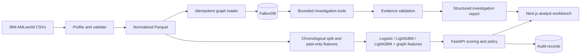

# TraceAML Architecture

## System boundaries

TraceAML is a local-first investigation workbench for replaying synthetic AML transactions. The first iteration includes data preparation and model evaluation, a FalkorDB-backed investigation service, deterministic decision policy, evidence validation, and an analyst UI.

It does not connect to banks, freeze funds, file regulatory reports, or claim production effectiveness. Distributed queues, Redis, vector search, Kubernetes, graph neural networks, and model fine-tuning are deferred.

## Repository map

```text
apps/web/                 Next.js analyst workbench
services/api/             FastAPI, policy, investigation orchestration
ml/                       Data inspection, preparation, features, models, metrics
graph/                    FalkorDB schema, indexes, and Cypher query definitions
data/raw/                 User-provided source data; ignored by Git
data/processed/           Normalized Parquet and split artifacts; ignored by Git
artifacts/                Generated models and benchmark runs; ignored by Git
docs/                     Product, architecture, contracts, decisions, role charters
compose.yaml              Local FalkorDB service
```

## Component flow



## Data and evaluation

Parquet is the analytical source of truth. The current workspace uses HI-Small Kaggle version 8. `traceaml-inspect-hi-small` writes an aggregate-only source profile; `traceaml-prepare-hi-small` validates and normalizes the transaction file and writes `data/processed/hi-small-v8/transactions.parquet` plus `split-manifest.json`. The manifest records the source hash, schema, composite account-key rule, exact split algorithm, boundaries, and label counts. Use Polars for generic CSV inspection, DuckDB for local analytical queries, and PyArrow/Parquet for durable intermediate tables.

Use a chronological train/validation/test split when timestamps permit it. HI-Small timestamps have one-minute resolution; choose nearest cumulative-count cutoffs to 70%/85% while keeping each full timestamp group together. Feature construction for transaction `t` may use only records strictly earlier than `t`; records at the same minute are simultaneous. Keep labels and typology ground truth in the offline evaluation path. They must not be written to the inference graph or returned by inference queries.

The first benchmark ladder is logistic regression, LightGBM with tabular and historical behavior features, and LightGBM with the same features plus graph-derived features. Train and tune without reading the frozen test labels, and report all models on the same held-out cohort.

## FalkorDB graph

FalkorDB is the authoritative source for transaction topology and structural investigation evidence. The initial graph contains `Account` and `Transaction` nodes connected by `SENT` and `RECEIVED` relationships. Transaction nodes carry a stable source transaction ID, timestamp, amounts, currencies, and payment type as supported by the input schema. Account keys include institution or bank when account IDs are reused.

The graph layer owns schema, indexes, ingestion, and parameterized Cypher. It exposes bounded operations for fund tracing, counterparty inspection, and selected flow patterns. Every response includes transaction references, timestamps, graph paths, and query duration. A missing graph result remains missing; neither the API, UI, nor LLM fills it in.

The initial setup creates the FalkorDB service and schema files. Full-dataset ingestion is deliberately postponed until the user supplies the data and representative memory/runtime behavior can be measured.

## API, policy, and investigation

FastAPI uses Pydantic request and response models. The API coordinates scoring, policy, graph tool calls, investigation reports, and audit records. The policy layer owns action mapping; model and LLM outputs are proposals only. The first policy actions are `allow`, `review`, and simulated `block`.

The investigation model is optional and is invoked only for selected cases. It receives a score plus records returned by approved graph tools. It may propose hypotheses and summarize evidence, but deterministic validation checks transaction IDs, paths, amounts, and timestamps against retrieved records before showing claims as established. Provider errors or invalid output fall back to deterministic review.

Only explicit analyst confirmation promotes entities into confirmed case memory. Dismissal preserves the transaction history and audit trail. Test/evaluation records never become confirmed memory automatically.

## Analyst workbench

Next.js App Router, TypeScript, Tailwind CSS, and shadcn/ui provide the web application. TanStack Query manages API state, Recharts presents recorded benchmark results, and Cytoscape.js renders graph evidence. The main areas are:

- **Alerts:** ranked transactions, scores, and policy outcomes.
- **Investigations:** evidence timeline and Cytoscape rendering of query-derived paths.
- **Benchmarks:** quality at stated alert budgets, latency, throughput, and cost.
- **System:** service state and replay controls.

The UI communicates that its data is a synthetic replay. It never creates graph facts locally; graph structure is rendered from the API's query-backed response.

## Local services and reliability

Docker Compose runs FalkorDB locally. The web app and API can run in their native development environments with pnpm and uv. Keep provider credentials in ignored environment files.

If FalkorDB is unavailable, graph-dependent investigation reports an explicit service error rather than presenting a partial graph as complete. If the optional LLM is unavailable or returns invalid data, continue with verified graph evidence and deterministic policy. Bound depth, time windows, result counts, and query execution time to protect the service and browser.
