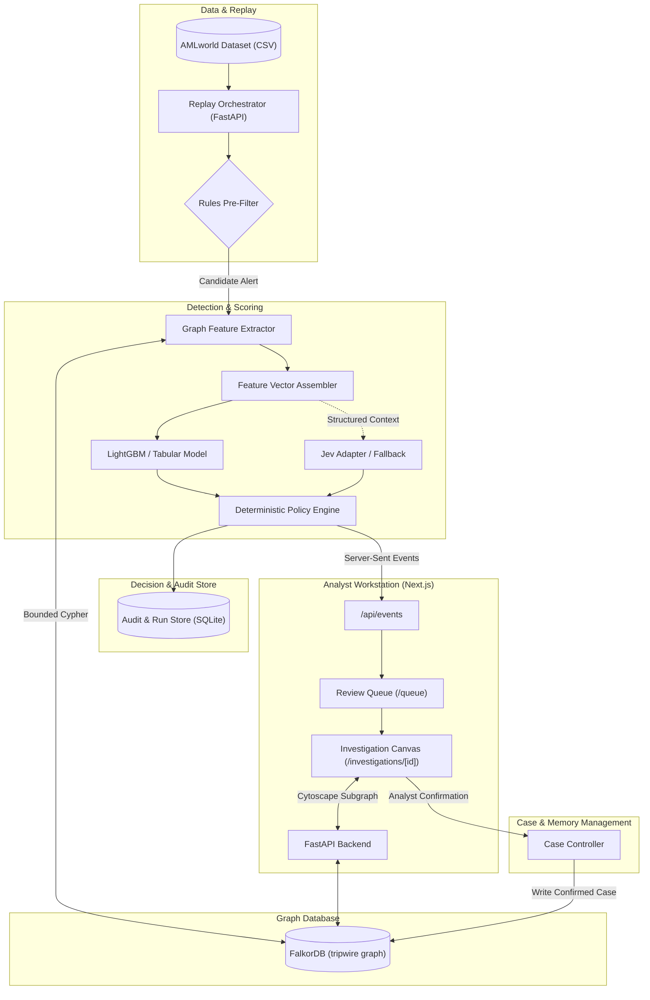
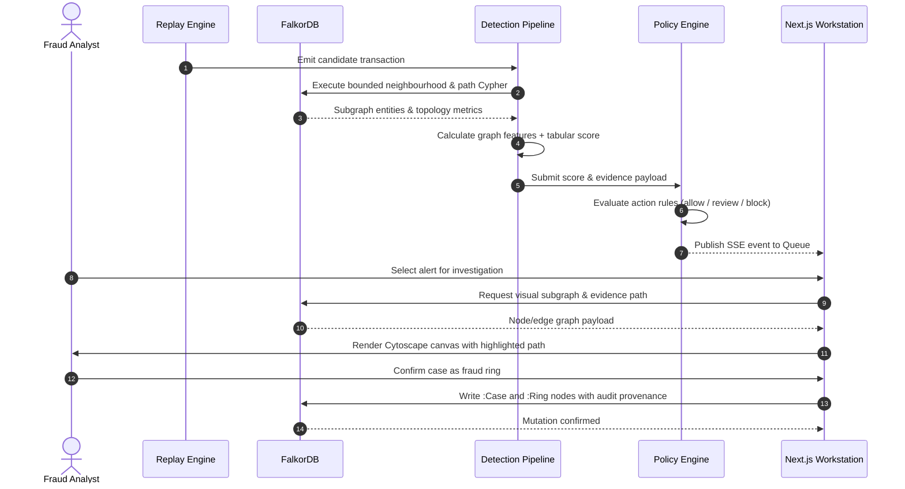

# Architecture Specification: Tripwire

## 1. Overview & System Boundaries

Tripwire is a graph-native fraud investigation platform designed for fraud and AML analysts. It processes incoming transactions, evaluates suspicious money-flow topologies via FalkorDB, surfaces inspectable multi-hop graph evidence, and records analyst-confirmed cases in an auditable graph memory store.

### System Boundaries

- **In-Scope**:
  - Replay and ingestion of synthetic AML transfer data (IBM AMLworld HI-Small).
  - Graph database storage, schema enforcement, and bounded query execution in FalkorDB.
  - Multi-hop topological feature extraction (fan-in, fan-out, cycles, scatter-gather flows).
  - Hybrid scoring pipeline: Tabular baseline, graph-derived structural features, optional typed LLM assessment.
  - Deterministic policy engine mapping scores and rules to `allow`, `review`, and simulated `block`.
  - Analyst investigation workspace with Cytoscape.js interactive graph canvas and evidence inspection.
  - Case memory management with provenance and explicit review gate.
  - Reproducible benchmark and graph ablation harness.

- **Out-of-Scope (Hackathon Baseline)**:
  - Real-world banking or payment gateway integrations.
  - Actual account blocking, fund freezes, or regulatory SAR filing.
  - Distributed message brokers (Kafka, RabbitMQ) and distributed caching (Redis).
  - Unbounded graph traversal or GNN training before baseline validation.

---

## 2. High-Level Architecture

---

## 3. Subsystem Breakdown

### 3.1 Frontend Workstation (`apps/web`)
- **Technology**: Next.js App Router, React 19, TypeScript, Tailwind CSS, shadcn/ui, Cytoscape.js, TanStack Query.
- **Role**: High-density analytical interface for triage, investigation, case review, and benchmark inspection.
- **Key Modules**:
  - `QueueView`: Virtualized table displaying real-time stream of transactions and alerts.
  - `GraphWorkspace`: Cytoscape.js canvas rendering bounded transaction neighbourhoods and highlighted evidence paths.
  - `EvidenceInspector`: Attribute inspection for nodes, transfers, and structural indicators.
  - `CaseManager`: Interface for promoting or dismissing suspected fraud rings.
  - `BenchmarkViewer`: Reproducible metrics, ROC/PR curves, and typology breakdowns.

### 3.2 Backend & API Service (`backend/api`)
- **Technology**: Python 3.12+, FastAPI, Pydantic v2, Uvicorn, managed via `uv`.
- **Role**: RESTful API endpoints, SSE event broadcasting, and lifecycle coordination.
- **Key Modules**:
  - `replay_orchestrator`: Deterministic clock managing transaction generation, pause, and reset.
  - `sse_broadcaster`: Lightweight Server-Sent Events channel streaming alerts to connected clients.
  - `investigation_router`: Dispatcher orchestrating graph retrieval, scoring, and policy evaluation.

### 3.3 Graph Engine (`backend/graph`)
- **Technology**: Official `falkordb` Python client, Cypher query suite.
- **Role**: Authoritative persistence of accounts, transactions, cases, and ring associations.
- **Key Queries**:
  - Bounded multi-hop neighbourhood retrieval around source and destination accounts.
  - Temporal fan-in and fan-out aggregation within configurable lookback windows.
  - Directed cycle detection up to depth $k$.
  - Shortest path between flagged accounts and prior confirmed fraud cases.

### 3.4 Detection & Model Service (`backend/detector`)
- **Technology**: scikit-learn, LightGBM / XGBoost, NumPy, Pandas.
- **Role**: Combines raw transaction metadata with graph-extracted topological signals.
- **Pipelines**:
  - `tabular_baseline`: Evaluates local transaction properties (amount, velocity, counterparty frequency).
  - `graph_augmented`: Concatenates structural metrics (degree centrality, cycle participation, scatter-gather indicators).
  - `llm_adapter`: Assembles a compact JSON prompt representing graph topology for typed evaluation via Jev (with deterministic heuristic fallback).

### 3.5 Deterministic Policy Engine (`backend/policy`)
- **Technology**: Pure Python rule evaluator.
- **Role**: Decouples model scoring from actionable enforcement.
- **Invariants**:
  - Enforces deterministic thresholds on validated model scores.
  - Routes malformed model outputs or provider timeouts to a safe fallback (`review`).
  - Emits immutable decision records containing timestamp, rule ID, model version, and computed evidence.

### 3.6 Case Memory Controller (`backend/memory`)
- **Technology**: FalkorDB Cypher mutators, SQLite provenance tracking.
- **Role**: Manages the transition of alerts from `suspected` to `confirmed` or `dismissed`.
- **Invariants**:
  - Only human analyst confirmation can write a confirmed `Ring` or link a `Case` to the graph.
  - Replay and evaluation pipelines must never write test set records into case memory.

---

## 4. End-to-End Data Flow

---

## 5. Resilience & Failure Modes

| Subsystem Failure | Impact | Mitigation Strategy |
| :--- | :--- | :--- |
| **FalkorDB Offline** | Cannot query or persist graph topology | Fast fail with HTTP 503. Log error; do not pretend graph evaluation occurred. |
| **LLM / Jev Timeout** | LLM assessment unavailable | Fallback immediately to deterministic policy and tabular model score. Route to manual review. |
| **Malformed LLM Output** | Invalid JSON or schema violation | Pydantic validation rejects payload; fallback policy triggers without pipeline crash. |
| **High-Degree Account Hub** | Traversal query explosion | Hard cap on Cypher search depth ($k \le 3$) and result count ($N \le 100$). |
| **SSE Connection Drop** | Frontend misses transaction ticks | Client automatically reconnects via `EventSource` and requests catch-up diff from `/api/transactions`. |
