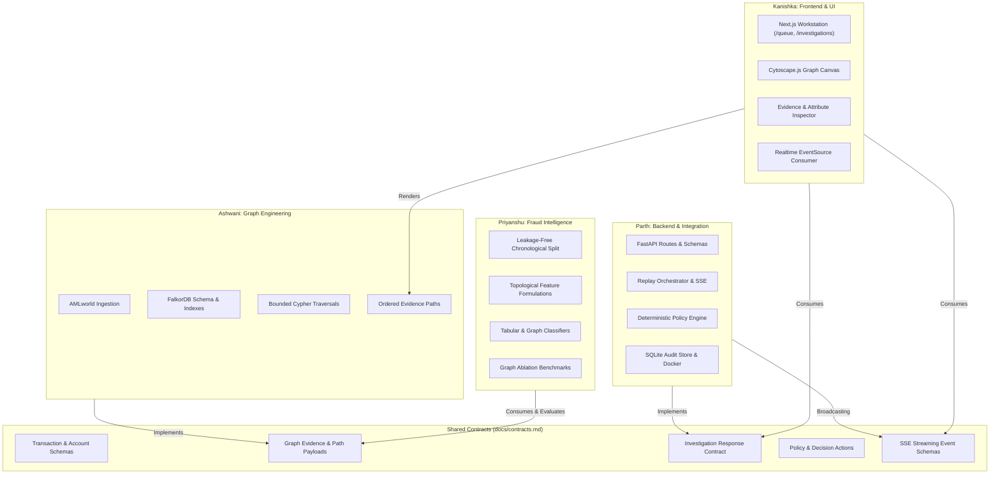

# Tripwire Project Milestones and Engineering Tracks

This directory contains the engineering roadmaps, milestone specifications, and architectural decision guides for the Tripwire graph-native fraud investigation platform.

---

## Directory Structure

```
docs/milestones/
├── README.md                 # This index and engineering track overview
├── overview.md               # Master system-wide roadmap (Phase 1 to Phase 4)
├── ashwani/
│   └── milestones.md         # FalkorDB & Graph Engineering Track
├── kanishka/
│   └── milestones.md         # Frontend & Product UI Track
├── parth/
│   └── milestones.md         # Backend, Agent & Integration Track
└── priyanshu/
    └── milestones.md         # Fraud Intelligence & Evaluation Track
```

---

## Engineering Ownership and Scope Boundaries

To maximize parallel velocity while maintaining rigorous subsystem decoupling, the engineering tracks are divided across four independent owners:

| Engineer | Track / Responsibility | Subsystem Domain | Primary Repositories / Paths |
| :--- | :--- | :--- | :--- |
| **Priyanshu** | Fraud Intelligence & Evaluation Lead | Detection, Feature Design & Evaluation | `evaluation/`, `backend/detector/`, `docs/decisions.md` |
| **Kanishka** | Frontend & Product UI Lead | Next.js Client & Graph Visualizations | `apps/web/`, `packages/ui/` |
| **Ashwani** | FalkorDB & Graph Engineering Lead | Graph Ingestion, Schema & Cypher Queries | `backend/graph/`, `scripts/ingest/` |
| **Parth** | Backend, Agent & Integration Lead | FastAPI, Replay, Policy & Deployment | `backend/api/`, `backend/policy/`, `docker-compose.yml` |



---

## Shared Architectural Invariants

All engineers must adhere to the following project invariants:

1. **Single Source of Truth**: All inter-service message schemas, graph query response payloads, and API signatures are defined in [`docs/contracts.md`](file:///home/bhondu/coding/hackathon/graph_hacks/tripwire/docs/contracts.md). Engineers must never define duplicate data interfaces across packages.
2. **Authoritative Graph Engine**: FalkorDB is the sole source of truth for graph topology and structural feature extraction. Graph evidence returned to the UI must derive directly from executed Cypher queries, never client-side or LLM fabrication.
3. **Evaluation and Label Isolation**: Target labels and laundering typology ground truth must never be ingested as inference features or returned in inference Cypher queries. Evaluation sets must remain strictly held out.
4. **Deterministic Policy Layer**: Model inference (ML or LLM) emits uncalibrated scores or proposals. The deterministic policy layer owns final decision mapping (`allow`, `review`, simulated `block`). Safe fallback to human review or deterministic rules is mandatory if model providers fail.
5. **Tooling Discipline**:
   - TypeScript workspaces are strictly managed via `pnpm` (`pnpm build`, `pnpm check-types`, `pnpm lint`).
   - Python backend and evaluation workspaces are strictly managed via `uv` (`uv venv`, `uv pip`, `uv run pytest`, `uv run ruff`).
6. **Zero Emoji Standard**: Strictly zero emojis across all code, comments, documentation, UI strings, and commit messages.
7. **Open-Ended Decision Making**: The individual milestone documents provide concrete input/output contracts and high-level deliverables, while leaving specific internal algorithms, library choices, and trade-offs open for engineer exploration and benchmarking.

---

## System Roadmap Reference

For the comprehensive end-to-end hackathon roadmap detailing Foundation (Phase 1), Vertical Slice (Phase 2), Differentiation (Phase 3), and Hardening & Submission (Phase 4), consult [overview.md](file:///home/bhondu/coding/hackathon/graph_hacks/tripwire/docs/milestones/overview.md).
