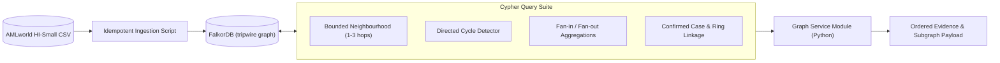

# Engineering Milestone Plan: FalkorDB & Graph Engineering Track

- **Owner**: Ashwani
- **Domain**: Graph Database Infrastructure, Schema Design, Data Ingestion & Cypher Query Engineering
- **Primary Workspace Paths**: `backend/graph/`, `scripts/ingest/`
- **Scope Boundary**: Strictly FalkorDB schema, ingestion scripts, and Cypher query execution. Detection models are owned by Priyanshu; HTTP dispatch and policy enforcement are owned by Parth; canvas rendering is owned by Kanishka.

---

## Executive Summary

The Graph Engineering track establishes FalkorDB as the authoritative engine for money-flow intelligence. This track ingests the IBM AMLworld HI-Small dataset idempotently, creates performance indexes, and implements bounded Cypher queries that extract multi-hop neighbourhoods, directed cycles, fan-in/fan-out metrics, and auditable evidence paths.



---

## Phase 1: Ingestion Pipeline, Schema & Constraints (Day 1)

### 1.1 Objective
Build an idempotent data ingestion pipeline for IBM AMLworld HI-Small, define graph schema constraints, create indexes, and verify basic Cypher traversals in FalkorDB.

### 1.2 Input and Output Contracts
- **Input Contract**: AMLworld CSV records (`Transaction_ID`, `Sender_Account`, `Receiver_Account`, `Amount`, `Timestamp`, etc.).
- **Graph Schema Contract**:
  - `(:Account {account_id, institution, created_at})`
  - `(:Transaction {transaction_id, amount, currency, timestamp, format})`
  - Relationship: `(src:Account)-[:SENT]->(tx:Transaction)-[:RECEIVED]->(dst:Account)`
  - Constraints: Uniqueness on `Account.account_id` and `Transaction.transaction_id`.
  - Indexes: Range index on `Transaction.timestamp`.

### 1.3 Architectural Seams and Technical Decisions

#### Decision Seam A: Ingestion Strategy
- **Option 1: Batch Cypher Queries with UNWIND (Recommended)**
  - *Pros*: Simple, runs inside standard Python client, transactional batches of 5,000-10,000 rows.
  - *Cons*: Moderate ingestion time for multi-million row datasets.
- **Option 2: FalkorDB Bulk Loader Tool (falkordb-bulk-loader)**
  - *Pros*: Maximum ingestion throughput.
  - *Cons*: Requires separate CSV preprocessing for headers and direct socket access; can fail on schema quirks during a fast-paced hackathon.
- *Recommendation*: Use batch UNWIND queries for predictable execution and deterministic rollback.

---

## Phase 2: Bounded Neighbourhood & Evidence Path Retrieval (Day 2)

### 2.1 Objective
Implement parameterized Cypher queries that retrieve bounded transaction neighbourhoods around target transfers, returning ordered node/edge paths matching `EvidencePath`.

### 2.2 Cypher Contract: Bounded Neighbourhood
```cypher
MATCH (tx:Transaction {transaction_id: $tx_id})
MATCH (src:Account)-[:SENT]->(tx)-[:RECEIVED]->(dst:Account)
OPTIONAL MATCH (src)<-[:RECEIVED]-(in_tx:Transaction)<-[:SENT]-(in_acc:Account)
WHERE in_tx.timestamp >= tx.timestamp - $time_window AND in_tx.timestamp <= tx.timestamp
OPTIONAL MATCH (dst)-[:SENT]->(out_tx:Transaction)-[:RECEIVED]->(out_acc:Account)
WHERE out_tx.timestamp >= tx.timestamp AND out_tx.timestamp <= tx.timestamp + $time_window
RETURN src, tx, dst,
       collect(DISTINCT in_tx)[..$limit] AS in_transfers,
       collect(DISTINCT out_tx)[..$limit] AS out_transfers
```

### 2.3 Architectural Seams and Technical Decisions

#### Decision Seam B: Guarding Against High-Degree Hub Accounts
- *Problem*: Super-node accounts (e.g. exchanges or payroll hubs) with 10,000+ transfers can cause Cypher memory spikes and freeze the frontend canvas.
- *Mitigation Options*:
  1. Strict Cypher slicing: `collect(DISTINCT tx)[..$limit]`.
  2. Hop limiting: Never expand beyond 2 hops on accounts with degree $> 500$.
  3. Time-window bounding: Restrict expansion to $[t - \Delta t, t + \Delta t]$.
- *Open to Owner*: Fine-tune query limits to balance analytical depth against sub-100ms response times.

---

## Phase 3: Graph Feature Extraction & Case Memory Mutators (Day 3)

### 3.1 Objective
Implement Cypher routines calculating structural indicators (cycles, fan-in/out, scatter-gather flows) for Priyanshu's detection pipeline, and build mutators for confirmed `:Case` and `:Ring` memory.

### 3.2 Case Memory Mutations
```cypher
MERGE (c:Case {case_id: $case_id})
ON CREATE SET c.status = 'confirmed', c.reviewed_at = $timestamp, c.reviewer_id = $reviewer_id
WITH c
MATCH (a:Account) WHERE a.account_id IN $account_ids
MERGE (c)-[:INVOLVES]->(a)
MERGE (r:Ring {ring_id: $ring_id})
ON CREATE SET r.pattern = $pattern_type, r.created_at = $timestamp
MERGE (c)-[:IDENTIFIES]->(r)
MERGE (r)-[:HAS_MEMBER]->(a)
```

---

## Phase 4: Query Optimization & README Documentation (Day 4)

### 4.1 Objective
Run latency profiles across all core queries, verify sub-50ms execution on held-out transactions, and document the graph schema and Cypher query library in the project README.

### 4.2 Completion Criteria
- Ingestion runs idempotently from scratch without duplicate nodes.
- Core Cypher queries execute within bounded limits with zero server memory warnings.
- README contains complete ASCII/Mermaid schema and copy-pasteable verification queries.
