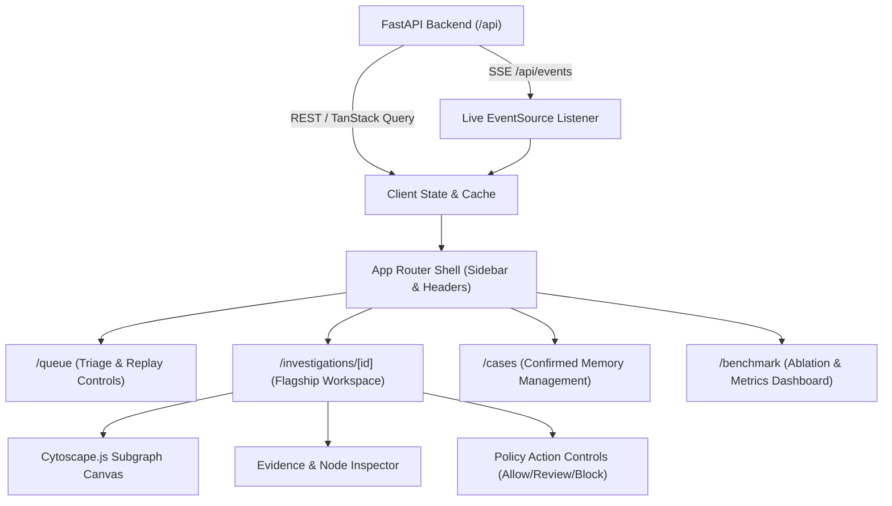

# Engineering Milestone Plan: Frontend & Product UI Track

- **Owner**: Kanishka
- **Domain**: Web Application, Information Architecture, Visual Design & Graph Interactions
- **Primary Workspace Paths**: `apps/web/`, `packages/ui/`
- **Scope Boundary**: Strictly client-side UI, styling, and graph visualization. API contracts, database queries, and detection logic are owned by upstream tracks.

---

## Executive Summary

The Frontend track delivers a high-density, dark editorial fintech workstation inspired by the Case 0021 reference. It renders real-time transaction alerts, visualizes multi-hop FalkorDB graph evidence via Cytoscape.js, and provides intuitive triage and case confirmation workflows for fraud analysts.



---

## Phase 1: Design System, Tokens & Mocked Queue Shell (Day 1)

### 1.1 Objective
Establish the Next.js application shell, configure Tailwind CSS with Case 0021-inspired lilac tokens, build navigation, and render the review queue table using mock API fixtures.

### 1.2 Input and Output Contracts
- **Input Contract**: Mock JSON fixtures implementing `TransactionQueueItem` defined in [`docs/contracts.md`](file:///home/bhondu/coding/hackathon/graph_hacks/tripwire/docs/contracts.md).
- **Design Tokens Contract**:
  - Background: `#0B0B10`
  - Panel: `#12121A`
  - Border: `#292936`
  - Primary Lilac Accent: `#B68CFF`
  - Semantic Status: Red (`#F87171`), Amber (`#F4B860`), Green (`#56D6A0`).

### 1.3 Architectural Seams and Technical Decisions

#### Decision Seam A: Table Component Strategy
- **Option 1: TanStack Table + shadcn/ui (Recommended)**
  - *Pros*: Headless, highly customizable, supports virtualized rendering for 500+ rows, clean sorting and filtering.
  - *Cons*: Slight setup overhead for custom cell formatters.
- **Option 2: Native HTML Table with Tailwind**
  - *Pros*: Fast initial scaffold.
  - *Cons*: Difficult to add robust column sorting, virtual scrolling, or sticky headers under tight deadlines.
- *Recommendation*: Use TanStack Table via shadcn/ui components.

---

## Phase 2: Live API Connectivity, SSE & Cytoscape Canvas (Day 2)

### 2.1 Objective
Connect the review queue to Parth's live REST API, subscribe to `/api/events` for real-time replay streaming, and implement the Cytoscape.js graph canvas on the investigation page.

### 2.2 Input and Output Contracts
- **Graph Payload Contract**:
  ```typescript
  interface CytoscapeGraphPayload {
    nodes: Array<{
      data: {
        id: string;
        label: string;
        type: 'Account' | 'Transaction';
        amount?: number;
        isFlagged?: boolean;
      };
    }>;
    edges: Array<{
      data: {
        id: string;
        source: string;
        target: string;
        type: 'SENT' | 'RECEIVED';
        isEvidencePath?: boolean;
      };
    }>;
  }
  ```

### 2.3 Architectural Seams and Technical Decisions

#### Decision Seam B: Cytoscape Layout Algorithm
- **Option 1: CoSE (Compound Spring Embedder) (Recommended for organic networks)**
  - *Pros*: Natural clustering for fan-in and fan-out structures; accounts for node degrees well.
  - *Cons*: Can be non-deterministic between renders if seed is not pinned.
- **Option 2: Dagre / Breadthfirst (Hierarchical / Directed flows)**
  - *Pros*: Excellent for directional money movement from source to destination.
  - *Cons*: Struggles with circular transfers or complex bipartite hubs.
- *Open to Owner*: Test CoSE vs. Dagre on real AMLworld topologies and select the cleanest analytical visual.

---

## Phase 3: Path Highlighting, Entity Inspector & Cases UI (Day 3)

### 3.1 Objective
Highlight backend-returned evidence paths in vibrant orange/red on the graph canvas, build the side inspector panel, and implement the `/cases` management interface.

### 3.2 Key Features
- **Path Highlighting**: Automatically apply visual styling (thickened borders, glowing orange strokes) to edges and nodes belonging to `evidence_paths`.
- **Node/Edge Inspector**: Clicking any entity opens details (account ID, institution, transfer timestamp, exact amount, prior flags).
- **Case Review Actions**: Provide buttons to confirm or dismiss suspected cases with confirmation dialogs.

---

## Phase 4: Polish, Error Boundaries & Demo Rehearsal (Day 4)

### 4.1 Objective
Add skeleton loaders, handle API disconnects gracefully, tune responsiveness for presentation screens, and ensure flawless interaction timing for the 90-second demo.

### 4.2 Completion Criteria
- UI loads zero mock data in live mode; all numbers, paths, and scores come from live backend responses.
- SSE reconnects automatically without breaking table scroll state.
- Graph canvas fits viewport smoothly with zoom/pan controls and legend.
