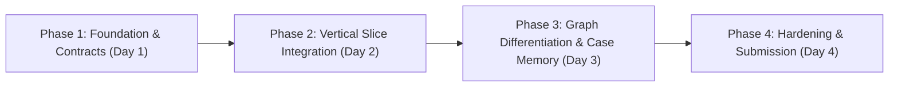

# Tripwire Roadmap and Master Milestones

This document tracks the technical execution plan, subsystem deliverables, completion criteria, and verification procedures for Tripwire across Phases 1 through 4 (15-18 October 2026).



---

## Phase 1: Foundation and Invariant Contracts (Day 1: 15 Oct 2026)

### Objective
Establish the hybrid monorepo foundation, Docker Compose local setup, FalkorDB schema and indexes, AMLworld data slice ingestion, baseline detection pipeline, and Next.js frontend shell with mock contracts.

### Status
In Progress

### Track Deliverables
- **Ashwani (Graph)**: Ingest sample AMLworld HI-Small data slice into FalkorDB; create constraints on `:Account(account_id)` and `:Transaction(transaction_id)`; implement first 2-hop neighbourhood Cypher query.
- **Parth (Backend)**: FastAPI application skeleton, Pydantic schemas reflecting [`docs/contracts.md`](file:///home/bhondu/coding/hackathon/graph_hacks/tripwire/docs/contracts.md), replay clock endpoints (`/api/replay/*`), and Docker Compose (`falkordb` + `api`).
- **Priyanshu (Detection)**: Leakage-safe chronological dataset split protocol; initial rules-only baseline detector with precision/recall benchmarks.
- **Kanishka (Frontend)**: Next.js workspace with Tailwind CSS, Case 0021-inspired lilac tokens, App Router shell, and Review Queue table rendered with mock JSON fixtures.

### Completion Criteria
- Docker Compose initializes `falkordb` and FastAPI backend cleanly.
- Cypher query on FalkorDB retrieves a real 2-hop transaction neighbourhood without syntax errors.
- Rules-only baseline runs on split dataset with zero label leakage.
- Frontend renders `/queue` with mock fixtures and proper status tags.

### Verification Steps
```bash
# 1. Start containers
docker compose up -d

# 2. Ingest sample data slice
uv run python -m scripts.ingest --sample

# 3. Test FalkorDB query
uv run python -m backend.graph.verify_connection

# 4. Run rules baseline
uv run python -m evaluation.baselines.rules_only

# 5. Build and run frontend
pnpm --filter @tripwire/web build
```

---

## Phase 2: Vertical Slice Integration (Day 2: 16 Oct 2026)

### Objective
Connect the end-to-end transaction loop: Replay service emits an event -> pre-filter flags candidate -> FalkorDB retrieves neighbourhood -> detector scores transaction -> policy engine applies deterministic action -> decision persists to SQLite -> SSE broadcasts event -> Next.js displays alert and Cytoscape renders highlighted path.

### Status
Planned

### Track Deliverables
- **Ashwani (Graph)**: Bounded multi-hop neighbourhood query returning ordered node/edge paths and attributes matching `EvidencePath` contract.
- **Parth (Backend)**: Wire investigation endpoint (`GET /api/investigations/{id}`); implement deterministic Policy Engine (`allow`, `review`, `block`); build SSE streaming channel (`/api/events`).
- **Priyanshu (Detection)**: Train first tabular classifier (LightGBM/XGBoost) using local transaction features; specify structural graph features.
- **Kanishka (Frontend)**: Connect `/queue` to live API and SSE stream; build Cytoscape.js canvas rendering backend-returned evidence paths on `/investigations/[id]`.

### Completion Criteria
- Selecting an alert in the UI triggers a live backend request that queries FalkorDB and returns genuine graph evidence.
- Cytoscape canvas highlights the exact path returned by the backend without client-side fabrication.
- Policy outcome and audit record persist with timestamp and rule ID.

### Verification Steps
```bash
# 1. Trigger replay tick
curl -X POST http://localhost:8000/api/replay/start

# 2. Verify investigation payload
curl http://localhost:8000/api/investigations/tx_sample_01

# 3. Verify SSE event emission
curl -N http://localhost:8000/api/events
```

---

## Phase 3: Graph Differentiation and Case Memory (Day 3: 17 Oct 2026)

### Objective
Implement multi-hop structural feature extraction, run graph ablation benchmarks to prove graph necessity, integrate Jev LLM adapter with fallback, and establish analyst-confirmed case memory in FalkorDB.

### Status
Planned

### Track Deliverables
- **Ashwani (Graph)**: Optimized Cypher queries for fan-in/out, cycles, and scatter-gather structures; Cypher mutators for creating confirmed `:Case` and `:Ring` nodes.
- **Priyanshu (Detection)**: Graph ablation benchmark comparing tabular baseline vs. tabular + graph features; per-pattern performance breakdown; evaluate Jev LLM lift vs. cost.
- **Parth (Backend)**: Jev LLM provider adapter with Pydantic validation and fallback to manual review; case review endpoint (`POST /api/cases/{id}/review`).
- **Kanishka (Frontend)**: Case management UI (`/cases`) supporting confirm/dismiss actions; benchmark dashboard (`/benchmark`) displaying ablation metrics and error matrices.

### Completion Criteria
- Benchmark demonstrates measurable detection difference (or latency/cost trade-off) between tabular-only and graph-augmented models.
- Confirming a case writes a `:Case` node into FalkorDB, and subsequent investigations retrieve it when linked accounts re-appear.
- Jev timeout or schema failure safely falls back to deterministic review without throwing 500 errors.

### Verification Steps
```bash
# 1. Run graph ablation benchmark
uv run python -m evaluation.benchmark --ablation

# 2. Confirm a test case via API
curl -X POST http://localhost:8000/api/cases/case_01/review \
  -H "Content-Type: application/json" \
  -d '{"action": "confirm", "reviewer_id": "analyst_1", "pattern_type": "fan_out"}'

# 3. Verify case retrieval in subsequent query
uv run python -m backend.graph.test_case_retrieval
```

---

## Phase 4: Hardening and Submission (Day 4: 18 Oct 2026)

### Objective
Conduct rigorous leakage audits, freeze benchmark numbers, verify clean cold-start deployment, document graph schema and queries, and record the 90-second demo.

### Status
Planned

### Track Deliverables
- **Ashwani (Graph)**: Schema and key Cypher documentation for README; final verification of query latency under load.
- **Priyanshu (Detection)**: Leakage audit of feature inputs; frozen benchmark metrics table; technical talking points for demo narrative.
- **Parth (Backend)**: Startup resilience tests (FalkorDB disconnect, replay reset); Docker Compose hardening; environment variable sanity checks.
- **Kanishka (Frontend)**: Visual polish, responsive sanity checks for queue and cases, loading skeletons, demo rehearsal.

### Completion Criteria
- Repository starts cleanly from a fresh clone via documented commands (`docker compose up`).
- Zero target-label leakage confirmed by automated tests.
- 90-second demo video recorded showing live transaction triage, FalkorDB path investigation, case confirmation, and ablation benchmark.

### Verification Steps
```bash
# 1. Fresh environment sanity test
docker compose down -v && docker compose up -d

# 2. Run full test suite
uv run pytest
pnpm test

# 3. Verify zero leakage test suite
uv run pytest evaluation/tests/test_leakage.py
```
