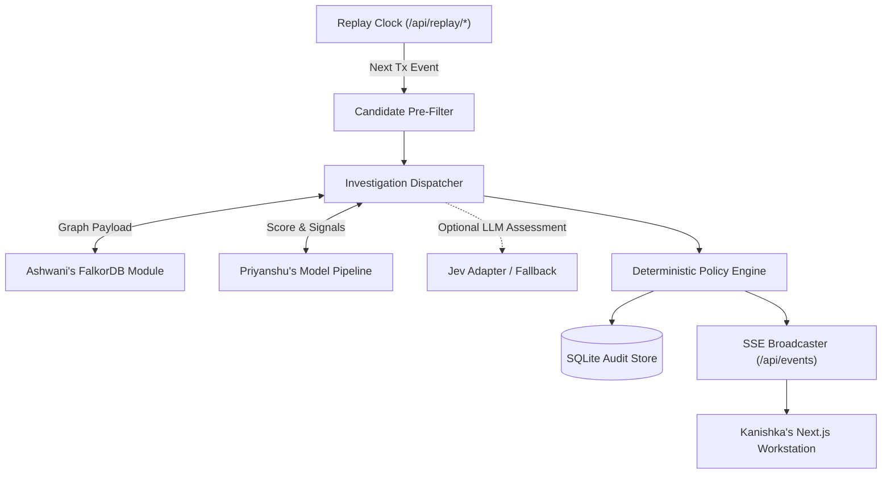

# Engineering Milestone Plan: Backend, Agent & Integration Track

- **Owner**: Parth
- **Domain**: Application Logic, API Contracts, Replay Orchestration, Policy Enforcement & System Deployment
- **Primary Workspace Paths**: `backend/api/`, `backend/policy/`, `backend/replay/`, `docker-compose.yml`
- **Scope Boundary**: Strictly backend routing, orchestration, deterministic policy, persistence, and container integration. Cypher query authoring is owned by Ashwani; statistical modeling by Priyanshu; web UI by Kanishka.

---

## Executive Summary

The Backend track provides the operational backbone for Tripwire. It coordinates the deterministic transaction replay clock, exposes REST endpoints matching shared contracts, pipes graph evidence into detection classifiers, executes deterministic policy rules, persists immutable audit records, and broadcasts live alerts to the frontend via Server-Sent Events.



---

## Phase 1: FastAPI Skeleton, Contracts & Docker Environment (Day 1)

### 1.1 Objective
Establish the FastAPI backend structure, implement Pydantic models conforming to `docs/contracts.md`, build replay start/pause/reset endpoints, and configure Docker Compose for local development.

### 1.2 Input and Output Contracts
- **Pydantic Data Contracts**:
  - `TransactionResponse`, `InvestigationResponse`, `CaseReviewRequest`, `ReplayStateResponse`.
- **Docker Compose Topology**:
  - `falkordb`: Official FalkorDB container exposed on port 6379.
  - `backend`: FastAPI Python 3.12+ container managed via `uv`, hot-reloading on port 8000.

### 1.3 Architectural Seams and Technical Decisions

#### Decision Seam A: Event Streaming Architecture (SSE vs. WebSockets)
- **Option 1: Server-Sent Events (SSE) (Recommended)**
  - *Pros*: Native browser `EventSource` support, automatic reconnection, simple HTTP/1.1 or HTTP/2 transport, unidirectional push matches replay alert stream perfectly.
  - *Cons*: Unidirectional only (actions like start/pause must use standard REST POST calls).
- **Option 2: WebSockets**
  - *Pros*: Full bidirectional communication on a single socket.
  - *Cons*: Greater protocol complexity, requires heartbeat ping/pong management, prone to connection drops through proxies.
- *Recommendation*: Use SSE for alert broadcasting and standard REST POST for commands.

---

## Phase 2: Vertical Slice Integration & Policy Engine (Day 2)

### 2.1 Objective
Wire the end-to-end investigation workflow (`GET /api/investigations/{id}`), execute deterministic policy rules on scores, persist decisions, and stream updates via SSE.

### 2.2 Deterministic Policy Logic Contract
```python
class PolicyEngine:
    def evaluate(self, score: float, graph_evidence: GraphFeatures) -> PolicyResult:
        if graph_evidence.cycle_detected or score >= 0.85:
            return PolicyResult(action="block", reason="High risk topology or high classifier confidence")
        elif score >= 0.50 or graph_evidence.fan_in_degree >= 10:
            return PolicyResult(action="review", reason="Moderate risk or anomalous fan-in")
        else:
            return PolicyResult(action="allow", reason="Normal transaction baseline")
```

### 2.3 Architectural Seams and Technical Decisions

#### Decision Seam B: Audit Store Technology
- **Option 1: SQLite with SQLModel / SQLAlchemy (Recommended)**
  - *Pros*: Zero external database infrastructure, embedded single-file storage, ACID guarantees, easy local inspection.
  - *Cons*: Concurrency limits if multiple processes write simultaneously (not an issue in single-server hackathon setup).
- **Option 2: Pure In-Memory Dictionary**
  - *Pros*: Zero setup.
  - *Cons*: History is lost whenever the server restarts; violates auditability requirements.
- *Recommendation*: Use SQLite with typed Pydantic/SQLModel mapping.

---

## Phase 3: Jev Provider Adapter & Case Review Endpoints (Day 3)

### 3.1 Objective
Integrate the typed Jev LLM adapter with strict timeout and validation guards, implement the case review endpoint (`POST /api/cases/{id}/review`), and trigger confirmed case mutations in FalkorDB.

### 3.2 Provider Resilience Guard
```python
async def query_jev_assessment(subgraph_summary: dict) -> JevAssessment:
    try:
        async with asyncio.timeout(2.0):  # Hard 2-second timeout
            response = await call_jev_api(subgraph_summary)
            return JevAssessment.model_validate(response)
    except (asyncio.TimeoutError, ValidationError, Exception) as exc:
        logger.warning(f"Jev provider unavailable or invalid: {exc}. Using deterministic fallback.")
        return JevAssessment.fallback(reason="Provider unavailable")
```

---

## Phase 4: Cold Start Hardening & System Stabilization (Day 4)

### 4.1 Objective
Ensure repeatable cold-start startup (`docker compose up`), test replay reset integrity, audit API response times, and provide deployment support for the live demo.

### 4.2 Completion Criteria
- Fresh startup initializes without manual intervention.
- Simulating FalkorDB or model provider disconnect produces clean HTTP 503 / fallback responses instead of unhandled 500 exceptions.
- API documentation (Swagger `/docs`) is completely populated with validated request/response examples.
