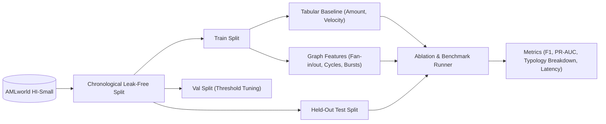

# Engineering Milestone Plan: Fraud Intelligence & Evaluation Track

- **Owner**: Priyanshu
- **Domain**: Fraud Detection, Feature Engineering & Quantitative Evaluation (Model Layer)
- **Primary Workspace Paths**: `evaluation/`, `backend/detector/`, `docs/decisions.md`
- **Scope Boundary**: Strictly detection algorithms, feature engineering, and evaluation protocols. Cypher execution is owned by Ashwani; API serving and policy enforcement are owned by Parth; UI presentation is owned by Kanishka.

---

## Executive Summary

The Fraud Intelligence track proves whether graph-derived structural context provides measurable detection lift over tabular transaction baselines. This track establishes a leak-free evaluation protocol on IBM AMLworld HI-Small, defines topological feature vectors, trains comparative classifiers, and quantifies latency/cost trade-offs.



---

## Phase 1: Dataset Validation, Leakage Quarantining & Rules Baseline (Day 1)

### 1.1 Objective
Establish an auditable chronological split on IBM AMLworld HI-Small, isolate target labels from inference data, and build the first deterministic rules-only baseline.

### 1.2 Input and Output Contracts
- **Input Contract**: Raw AMLworld HI-Small CSV records.
- **Output Contract**: Normalized train, validation, and test dataset partitions stored with cryptographic hashes to prevent data leakage:
  ```python
  class SplitManifest(BaseModel):
      split_id: str
      train_tx_count: int
      val_tx_count: int
      test_tx_count: int
      cutoff_timestamp_train: int
      cutoff_timestamp_val: int
      sha256_hash: str
  ```

### 1.3 Architectural Seams and Technical Decisions

#### Decision Seam A: Split Methodology
- **Option 1: Strict Chronological Split (Recommended)**
  - *Pros*: Completely mirrors production reality where future transactions cannot inform past features.
  - *Cons*: Older fraud typologies might have different statistical distributions from newer ones.
- **Option 2: Grouped Entity Holdout (Out-of-sample account clusters)**
  - *Pros*: Evaluates generalization to entirely new account networks.
  - *Cons*: Prone to network border leakage unless entire connected components are isolated.
- *Recommendation for Evaluation*: Use strict chronological split as primary benchmark; test grouped holdout only if time permits as secondary experiment.

#### Decision Seam B: Rules-Only Baseline Heuristics
- *Options*: Configurable threshold rules on transaction amount, round-amount flags, high-frequency transaction bursts, and known counterparty velocity.
- *Open to Owner*: Define exact threshold parameters and evaluate precision/recall tradeoffs.

---

## Phase 2: Tabular Classifier & Graph Feature Specification (Day 2)

### 2.1 Objective
Train an initial supervised tabular classifier and formalize the mathematical specifications for graph-derived features in collaboration with Ashwani.

### 2.2 Input and Output Contracts
- **Feature Vector Interface**:
  ```python
  class FeatureVector(BaseModel):
      transaction_id: str
      # Local tabular features
      log_amount: float
      sender_tx_count_30d: int
      receiver_tx_count_30d: int
      time_since_last_tx_sec: float
      # Graph-derived structural features (joint with Ashwani)
      fan_in_degree: int
      fan_out_degree: int
      cycle_detected: bool
      cycle_min_length: Optional[int]
      scatter_gather_ratio: float
      prior_case_proximity_hops: Optional[int]
  ```

### 2.3 Architectural Seams and Technical Decisions

#### Decision Seam C: Model Architecture
- **Option 1: LightGBM / XGBoost (Recommended)**
  - *Pros*: Fast training, handles tabular and count features naturally, interpretable feature importances, low inference latency (<10ms).
  - *Cons*: Requires tabularization of graph signals.
- **Option 2: Graph Neural Networks (GNN / GraphSAGE)**
  - *Pros*: End-to-end representation learning.
  - *Cons*: High latency, high setup burden, severe risk to hackathon Day 2 vertical slice.
- *Recommendation*: Use LightGBM as primary production baseline; defer GNNs per non-goals.

---

## Phase 3: Graph Ablation Benchmark & Typology Analysis (Day 3)

### 3.1 Objective
Run rigorous graph ablation experiments comparing tabular-only vs. tabular + graph features on the identical held-out test split, and evaluate whether LLM assessment (Jev) adds defensible value.

### 3.2 Key Experiments
1. **Rules Baseline**: Heuristic operational benchmark.
2. **Tabular Baseline**: Feature model without graph inputs.
3. **Tabular + Graph**: Model augmented with Ashwani's Cypher-extracted topological features.
4. **Tabular + Graph + Jev**: Hybrid assessment incorporating typed LLM reasoning.

### 3.3 Architectural Seams and Technical Decisions

#### Decision Seam D: Jev / LLM Inclusion
- *Trade-off*: LLM inference adds 500ms-2000ms latency and API cost per decision. Does it improve F1 or explainability enough to justify inclusion?
- *Decision Rule*: If Jev does not produce a statistically defensible improvement in F1 or value-weighted recall on validation data, report it honestly as a latency/cost trade-off study and retain the pure graph model as primary.

---

## Phase 4: Leakage Audit & Submission Verification (Day 4)

### 4.1 Objective
Freeze model thresholds on validation data, execute automated leakage assertions, and finalize the benchmark presentation.

### 4.2 Completion Criteria
- Automated test verifies no test labels exist in training or validation splits.
- All benchmark metrics (Precision, Recall, F1, PR-AUC, Latency p50/p95, Cost) are generated from actual runs and clearly labeled as synthetic AMLworld results.
